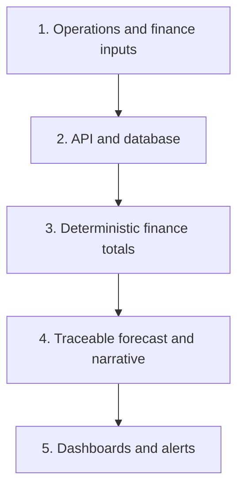

<div align="center">

# Greenhouse Farm AI

**Bilingual farm operations platform**

Full-stack MVP connecting greenhouse operations, finance and traceable AI-assisted forecasting — English and Arabic.

[](https://agri-web-uff8.onrender.com/login)
[](https://agri-api-j045.onrender.com/docs)
[](https://mounir-gmamsi.netlify.app/)

</div>

---

## Overview

Greenhouse Farm AI is a bilingual English/Arabic platform for greenhouse operations. It links crop cycles and harvests to sales, expenses, deterministic profitability and interpretable financial forecasting. Authoritative totals are calculated with Decimal arithmetic — not invented by a language model.

**Web:** [agri-web-uff8.onrender.com](https://agri-web-uff8.onrender.com/login) · **API docs:** [agri-api-j045.onrender.com/docs](https://agri-api-j045.onrender.com/docs)

---

## What the product delivers

| Capability | Description |
|------------|-------------|
| Operations | Greenhouses, crop cycles and harvest tracking |
| Finance | Sales, expenses and deterministic profitability |
| Traceable AI analysis | Interpretable forecast plus grounded bilingual narrative |
| Bilingual UX | English and Arabic (RTL) interface |
| Observability | Metrics, traces and alert responder path |
| Delivery | Docker Compose local stack and cloud deploy |

---

## Technology stack

### Backend and data


### Frontend and delivery


### Observability


| Layer | Technologies |
|-------|----------------|
| API | FastAPI, PostgreSQL, Decimal finance engine |
| Web | SPA (AlFilaha), legacy React client retained |
| Platform | Docker Compose, Render, GitHub Actions |
| Observability | Prometheus, Grafana, OpenTelemetry, responder service |

---

## Solution flow

| Step | Stage | Technologies |
|:----:|-------|--------------|
| 1 | Capture farm operations data | Web + API |
| 2 | Persist domain model | PostgreSQL, FastAPI |
| 3 | Compute finance facts | Decimal arithmetic |
| 4 | Produce traceable forecast | Interpretable trend model + templates |
| 5 | Monitor and alert | Observability stack + responder |



---

## Repository structure

| Path | Purpose |
|------|---------|
| `apps/` | Web clients |
| `services/api` | FastAPI backend |
| `services/responder` | Alert remediation agent |
| `infra/` | Observability stack |
| `docs/` | Architecture, API, runbooks |
| `compose.yaml` | Local full-stack system |

---

## Run locally

```powershell
copy .env.example .env
docker compose up --build
```

- Web: http://localhost:3000  
- API docs: http://localhost:8000/docs  

More detail: [docs/architecture.md](docs/architecture.md) · [docs/deployment.md](docs/deployment.md)

---

## Author

**Mounir Gmamsi**  
[Portfolio](https://mounir-gmamsi.netlify.app/) · [GitHub](https://github.com/Mr-Gms-33) · [LinkedIn](https://www.linkedin.com/in/mounir-gmamsi-1595951b3)
