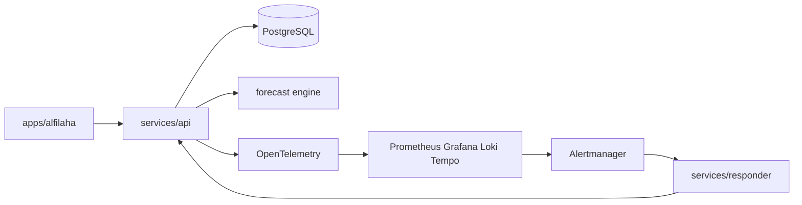

# Architecture

## Stack

| Layer | Choice |
|---|---|
| Web | AlFilaha Pro static SPA (`apps/alfilaha`, EN/AR) |
| API | FastAPI, Pydantic v2, SQLAlchemy 2, Alembic |
| Database | PostgreSQL 16 |
| Auth | JWT bearer tokens, bcrypt password hashes |
| Money | Python Decimal, round-half-up to 2 places |
| Forecast | Interpretable time-trend regression (scikit-learn) |
| Narrative | Deterministic EN/AR templates (LLM optional, never for arithmetic) |
| Containers | Docker Compose |
| Telemetry | OpenTelemetry traces/metrics + structured JSON logs |
| Responder | Allowlisted webhook agent enabling summary-only mode |

## Components

## Domain entities

- `users` — email, password_hash, role (owner|manager|accountant), locale, active
- `greenhouses` — name/code, area_m2, status, notes, soft-delete
- `crop_cycles` — greenhouse_id, crop, planting_date, expected_end_date, status
- `harvest_events` — crop_cycle_id, harvest_date, quantity_kg, grade, notes
- `customers` — name, contact_ref
- `sales` — customer_id, crop_cycle_id, sale_date, quantity_kg, unit_price_mad, channel
- `expenses` — expense_date, category, amount_mad, scope, greenhouse_id?, crop_cycle_id?
- `financial_analyses` — cutoff_month, facts JSON, forecast JSON, model_version, source_hash, stale
- `audit_events` — actor_id, action, entity_type, entity_id, field_names
- `incidents` — alert_name, status, actions, evidence

## Money and timezone

- Currency: MAD, two decimal places, ROUND_HALF_UP
- Farm timezone: Africa/Casablanca
- Analysis months are complete calendar months in that timezone

## Authorization matrix

| Resource | Owner | Manager | Accountant |
|---|---|---|---|
| Users | RW | - | - |
| Greenhouses / cycles / harvests | RW | RW | R |
| Customers / sales / expenses | RW | - | RW |
| Financial reports / analyses | RW | - | RW |
| Audit / incidents | R | - | - |

Backend enforcement is mandatory.
